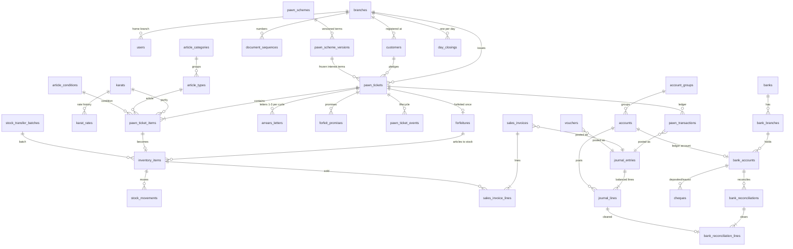
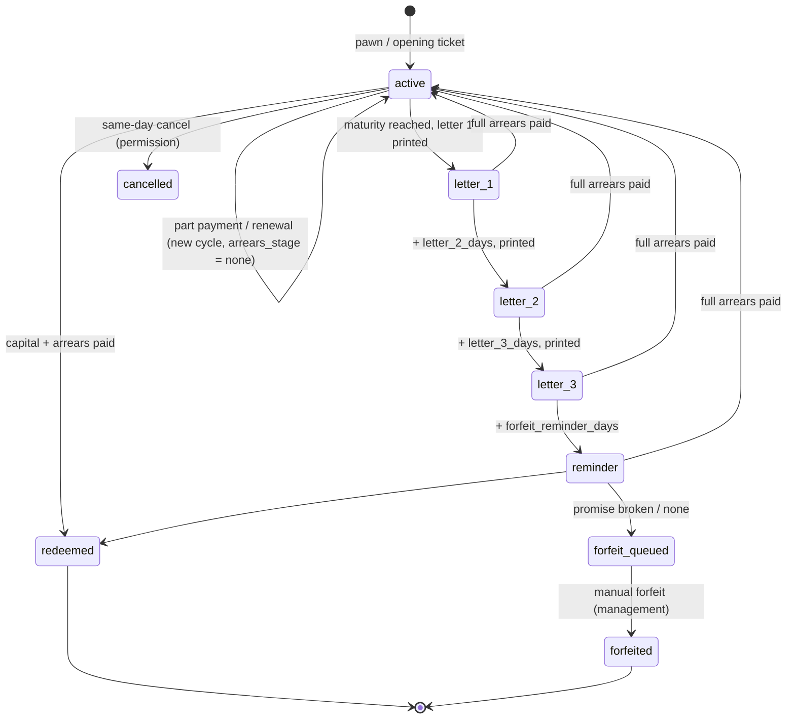

# Sampath Pawning — Database Design

MySQL 8.4 · `utf8mb4_unicode_ci` · InnoDB · timezone Asia/Colombo.
Source of truth for the migrations written in phase 2. Rationale and old→new mapping: see `REBUILD_PLAN_AND_DB_DESIGN.md`.

## Entity–relationship overview

## Pawn ticket lifecycle (status / arrears_stage)

Conventions: `id` bigint unsigned AI on every table; FKs `->constrained()->restrictOnDelete()` (cascade only for child line tables); money `decimal(15,2)`; weight `decimal(10,3)`; rates `decimal(7,4)`; dates `date`/`datetime`; booleans `NOT NULL DEFAULT 0`; `created_by`/`updated_by` FK users where noted; timezone Asia/Colombo.

### 3.1 Foundation
| Table | Columns | Indexes |
|---|---|---|
| `companies` | name, reg_no, address, phone, email, logo_path, receipt_footer, timestamps | — |
| `branches` | code char(3), name, address, phone1, phone2, opened_on, is_active, timestamps, soft deletes | UQ(code) |
| `users` | branch_id FK, username, name, email null, phone, password, is_active, last_login_at, remember_token, timestamps, soft deletes | UQ(username), UQ(email), IX(branch_id, is_active) |
| `user_branches` | user_id FK, branch_id FK | PK(user_id, branch_id) |
| spatie tables | roles, permissions, model_has_roles, model_has_permissions, role_has_permissions | package defaults |
| `personal_access_tokens`, `sessions`, `jobs`, `failed_jobs`, `cache` | Laravel defaults | defaults |
| `document_sequences` | branch_id FK, doc_type varchar(30), prefix varchar(10), next_number bigint, padding tinyint | UQ(branch_id, doc_type) |
| `settings` | branch_id FK null, key varchar(60), value json | UQ(branch_id, key) |
| `audit_logs` | user_id FK null, branch_id FK null, auditable_type, auditable_id, event varchar(30), old_values json, new_values json, ip, user_agent, created_at | IX(auditable_type, auditable_id), IX(user_id, created_at), IX(branch_id, created_at) |

### 3.2 Masters
| Table | Columns | Indexes |
|---|---|---|
| `karats` | code ('22K'), name, purity decimal(5,2), sort_order, is_active | UQ(code) |
| `karat_rates` | karat_id FK, effective_from datetime, pawn_rate_per_8g, assess_rate_per_8g, market_rate_per_8g, sale_rate_per_8g (decimal 12,2), created_by | IX(karat_id, effective_from) — "latest ≤ now" lookup |
| `article_categories` | name, metal varchar(10) (gold/silver/other), is_active | UQ(name) |
| `article_types` | category_id FK, code, name, is_active | UQ(code), UQ(category_id, name) |
| `article_conditions` | name, is_active | UQ(name) |
| `pawn_schemes` | code ('A','B','C','SILVER','D'), name, metal, interest_method (tiered / monthly_penalty / silver), is_active, timestamps | UQ(code) |
| `pawn_scheme_versions` (immutable) | scheme_id FK, effective_from date, effective_to date null, min_amount, max_amount null, valid_months tinyint, valid_days smallint, period1_days, rate1, period2_days, rate2, period3_days, rate3, penalty_rate_monthly, document_charge, stamp_duty, service_charge_flat, service_charge_threshold, service_charge_percent, postage_charge, letter_1_days, letter_2_days, letter_3_days, forfeit_reminder_days (default 21), min_capital_after_part_payment (1000), max_term_months (12), created_by, created_at | IX(scheme_id, effective_from, effective_to), IX(effective_from, min_amount) |

### 3.3 Customers
| Table | Columns | Indexes |
|---|---|---|
| `customers` | branch_id FK (registered at), code varchar(20), title, first_name, middle_name, last_name, full_name (stored), gender, nic varchar(20), driving_license, passport, other_identification, date_of_birth, address_line1, address_line2, city, phone1, phone2, email, photo_path, status (active/inactive/blacklisted), pawn_amount_limit null, pawn_count_limit null, notes, created_by, updated_by, timestamps, soft deletes | **UQ(nic)**, UQ(code), IX(phone1), IX(branch_id, status), IX(full_name), FULLTEXT(full_name, address_line1) |
| `customer_documents` | customer_id FK cascade, type, file_path, uploaded_by, created_at | IX(customer_id) |

One customer record globally (old allowed same NIC per branch — causes duplicate limit logic).

### 3.4 Pawning core
**`pawn_tickets`** (replaces t_pawn_sums, t_opening_pawn_sums, t_delete_pawn_sums, receipts, cancel__pawnings)
- branch_id FK, customer_id FK, scheme_id FK, scheme_version_id FK (frozen interest terms — versions are immutable, so no 20-column snapshot)
- receipt_no, ticket_no, stock_no (varchar 20, per-branch sequences)
- pawn_date date, cycle_start_date date, maturity_date date, valid_months tinyint
- gross_weight, net_weight (10,3); assessed_value, market_value, principal_original, principal_current, interest_carried, interest_paid_cycle (15,2)
- status (active / redeemed / forfeited / cancelled), arrears_stage (none / letter_1 / letter_2 / letter_3 / reminder / forfeit_queued), letter_cycle smallint default 1
- is_blocked, blocked_at, blocked_by FK, block_reason
- forfeit_queued_at, redeemed_at, forfeited_at, cancelled_at, cancelled_by FK, cancel_reason
- is_opening bool, legacy_receipt_no null
- created_by, updated_by, timestamps
- Indexes: **UQ(branch_id, receipt_no)**, UQ(branch_id, ticket_no), UQ(branch_id, stock_no), IX(customer_id, status), IX(branch_id, status, maturity_date), IX(branch_id, arrears_stage, status), IX(branch_id, pawn_date), IX(status, forfeit_queued_at), IX(legacy_receipt_no)

**`pawn_ticket_items`** (replaces t_pawn_details, t_opening_pawn_details, t_delete_pawn_details, t_forfit_details)
- pawn_ticket_id FK cascade, category_id FK, article_type_id FK, condition_id FK, karat_id FK, description, quantity smallint, gross_weight, net_weight, karat_rate_per_8g (snapshot), assessed_value, market_value, status (pledged / redeemed / forfeited / in_stock / sold), photo_path
- IX(pawn_ticket_id), IX(status), IX(karat_id)

**`pawn_transactions`** (one table replaces t_pawn_trans, t_pawn_payments, t_redeem_sums, t_repawning_sums, t_forfeit_sums, t_customer_accounts)
- branch_id FK, pawn_ticket_id FK, txn_no varchar(20), type (pawn / part_payment / renewal / redemption / forfeit / letter_charge / rounding / cancellation / reversal)
- txn_at datetime, business_date date, interest_days smallint
- principal_before, interest_due, interest_paid, interest_capitalised, service_charge, postage_charge, document_charge, stamp_duty, discount, principal_paid, principal_added, principal_after, cash_received, cash_paid (all 15,2)
- new_maturity_date null, new_scheme_version_id FK null, payment_method (cash / cheque / bank), cheque_id FK null
- reversal_of_id FK self null, journal_entry_id FK null, remarks, created_by
- Indexes: **UQ(branch_id, txn_no)**, IX(pawn_ticket_id, txn_at), IX(branch_id, type, business_date), IX(created_by, business_date), IX(journal_entry_id)

**Arrears / lifecycle**
| Table | Columns | Indexes |
|---|---|---|
| `arrears_letters` | pawn_ticket_id FK, branch_id FK, cycle_no smallint, letter_no tinyint, due_date, issued_at, postage_charge, service_charge, issued_by FK, reprint_count, last_reprinted_at | **UQ(pawn_ticket_id, cycle_no, letter_no)**, IX(branch_id, issued_at), IX(due_date) |
| `forfeit_promises` | pawn_ticket_id FK, cycle_no, promise_date, remark, status (pending/extended/kept/broken), previous_promise_id FK self, created_by, updated_by, timestamps | IX(pawn_ticket_id, cycle_no, status), IX(promise_date, status) |
| `pawn_ticket_events` | pawn_ticket_id FK, event_type varchar(40), event_at, amount null, description, payload json, user_id FK | IX(pawn_ticket_id, event_at), IX(event_type, event_at) |
| `pawn_remarks` | pawn_ticket_id FK, customer_id FK, remark text, user_id FK, created_at | IX(pawn_ticket_id), IX(customer_id) |
| `stock_check_sessions` | branch_id FK, started_at, completed_at, started_by, status | IX(branch_id, started_at) |
| `stock_check_lines` | session_id FK cascade, pawn_ticket_id FK, checked_at, checked_by | UQ(session_id, pawn_ticket_id) |

### 3.5 Forfeit, inventory, sales
| Table | Columns | Indexes |
|---|---|---|
| `forfeitures` | branch_id FK, forfeit_no, pawn_ticket_id FK, forfeit_date, principal_at_forfeit, interest_at_forfeit, charges_at_forfeit, total_due, approved_by FK, created_by, journal_entry_id FK | UQ(branch_id, forfeit_no), **UQ(pawn_ticket_id)** |
| `stock_transfer_batches` | branch_id FK, batch_no, transferred_at, user_id FK, notes | UQ(branch_id, batch_no) |
| `inventory_items` | branch_id FK, item_code, barcode, source (forfeit/purchase), forfeiture_id FK null, pawn_ticket_item_id FK null, transfer_batch_id FK null, category_id, article_type_id, karat_id, description, quantity, gross_weight, net_weight, cost_price, sale_price, status (in_stock/reserved/sold/written_off), received_at, sold_at | UQ(item_code), UQ(barcode), UQ(pawn_ticket_item_id), IX(branch_id, status), IX(category_id, status) |
| `stock_movements` | inventory_item_id FK, branch_id FK, movement_type (forfeit_in/sale/return/adjustment/write_off), qty_in, qty_out, reference_type, reference_id, moved_at, user_id | IX(inventory_item_id, moved_at), IX(branch_id, movement_type, moved_at), IX(reference_type, reference_id) |
| `sales_invoices` | branch_id FK, invoice_no, invoice_date, customer_id FK null, customer_name, customer_phone, gross_amount, discount, net_amount, paid_cash, paid_card, paid_cheque, credit_amount, status (completed/voided), voided_by, void_reason, journal_entry_id FK, created_by | UQ(branch_id, invoice_no), IX(branch_id, invoice_date), IX(customer_id) |
| `sales_invoice_lines` | sales_invoice_id FK cascade, inventory_item_id FK, description, qty, unit_price, discount, line_total | IX(sales_invoice_id), IX(inventory_item_id) |

### 3.6 Accounting (double-entry)
| Table | Columns | Indexes |
|---|---|---|
| `account_groups` | code, name, type (asset/liability/equity/income/expense), parent_id FK self | UQ(code) |
| `accounts` | code varchar(20), name, account_group_id FK, type, normal_balance (debit/credit), branch_id FK null (null = all branches), is_cash, is_bank, is_system, system_key varchar(40) null, opening_balance, is_active | UQ(code), **UQ(system_key)**, IX(type, is_active) |
| `journal_entries` | branch_id FK, entry_no, entry_date date, source_type, source_id, narration, status (posted/reversed), reversal_of_id FK self, posted_by, posted_at, created_by | UQ(branch_id, entry_no), IX(branch_id, entry_date), IX(source_type, source_id) |
| `journal_lines` | journal_entry_id FK cascade, account_id FK, branch_id FK, entry_date (denorm), debit, credit, description, pawn_ticket_id FK null, customer_id FK null | IX(account_id, entry_date), IX(branch_id, account_id, entry_date), IX(journal_entry_id), IX(pawn_ticket_id) |
| `day_closings` | branch_id FK, business_date, opening_cash, total_in, total_out, closing_cash, physical_cash null, variance, status (open/closed), closed_by, closed_at | **UQ(branch_id, business_date)** |
| `vouchers` (payment voucher, general receipt, expense, petty cash) | branch_id FK, voucher_no, type, voucher_date, party_name, account_id FK, cash_account_id FK, amount, description, status (draft/pending/approved/rejected/posted), requested_by, approved_by, approved_at, attachment_path, journal_entry_id FK | UQ(branch_id, voucher_no), IX(branch_id, status, voucher_date), IX(type, voucher_date) |

System accounts seeded by `system_key`: `cash`, `pawn_loans_receivable`, `interest_income`, `service_charge_income`, `postage_income`, `document_charge_income`, `stamp_duty_payable`, `discount_allowed`, `rounding`, `forfeited_stock`, `sales_income`, `cost_of_sales`, `cheques_in_hand`.
Posting examples: Pawn → Dr Loans / Cr Cash. Redemption → Dr Cash, Dr Discount / Cr Loans, Cr Interest Income, Cr Service, Cr Postage. Capitalised interest → Dr Loans / Cr Interest Income. Forfeit → Dr Forfeited Stock / Cr Loans (+ accrued interest per policy).

### 3.7 Banking
| Table | Columns | Indexes |
|---|---|---|
| `banks` | code, name | UQ(code) |
| `bank_branches` | bank_id FK, code, name | UQ(bank_id, code) |
| `bank_accounts` | branch_id FK, bank_branch_id FK, account_no, account_name, account_id FK (chart), is_active | UQ(account_no), UQ(account_id) |
| `cheques` | branch_id FK, direction (received/issued), cheque_no, bank_branch_id FK, bank_account_id FK null, party_name, amount, cheque_date, status (in_hand/deposited/cleared/returned/issued/presented/cancelled), deposited_at, cleared_at, returned_at, return_reason, source_type, source_id, journal_entry_id FK | IX(branch_id, status, cheque_date), IX(bank_account_id, status), IX(cheque_no), IX(source_type, source_id) |
| `bank_reconciliations` | bank_account_id FK, statement_date, statement_balance, book_balance, status, reconciled_by | UQ(bank_account_id, statement_date) |
| `bank_reconciliation_lines` | reconciliation_id FK cascade, journal_line_id FK, cleared_date | UQ(journal_line_id) |

### 3.8 Documents
| `printed_documents` | branch_id FK, document_type, documentable_type, documentable_id, file_path (private), print_count, printed_by, last_printed_at | IX(documentable_type, documentable_id), IX(branch_id, document_type) |

**Total ≈ 45 tables** (vs 53 old), every relation enforced by FK.

---

---

## Phase 2 — as implemented

**Migrations** (`api/database/migrations`, run in this order):

| File | Tables |
|---|---|
| `0001_01_00_000000_create_companies_and_branches_tables` | companies, branches |
| `0001_01_01_000000_create_users_table` | users, user_branches, password_reset_tokens, sessions |
| Laravel / package defaults | cache, jobs, personal_access_tokens, spatie permission tables |
| `…200001_create_core_support_tables` | document_sequences, settings, audit_logs |
| `…200002_create_master_tables` | karats, karat_rates, article_categories, article_types, article_conditions, pawn_schemes, pawn_scheme_versions |
| `…200003_create_customer_tables` | customers, customer_documents |
| `…200004_create_accounting_core_tables` | account_groups, accounts, journal_entries |
| `…200005_create_banking_tables` | banks, bank_branches, bank_accounts, cheques |
| `…200006_create_pawning_tables` | pawn_tickets, pawn_ticket_items, pawn_transactions, arrears_letters, forfeit_promises, pawn_ticket_events, pawn_remarks, stock_check_sessions, stock_check_lines |
| `…200007_create_ledger_and_voucher_tables` | journal_lines, day_closings, vouchers |
| `…200008_create_forfeit_inventory_sales_tables` | forfeitures, stock_transfer_batches, inventory_items, stock_movements, sales_invoices, sales_invoice_lines |
| `…200009_create_reconciliation_and_document_tables` | bank_reconciliations, bank_reconciliation_lines, printed_documents |

Result: 58 tables (44 business + 14 framework), all InnoDB / `utf8mb4_unicode_ci`, 118 foreign keys, 234 indexes.
Column helpers (`money`, `weight`, `rate`, `status`, `userRef`, `userStamps`, `branchRef`) are Blueprint macros in `app/Providers/AppServiceProvider.php`.

**Details refined while implementing**
- `config/database.php` forces `engine => InnoDB` — the local MySQL default is MyISAM, which silently ignores foreign keys.
- `karats` are the old *rate grades* (A0–B4 22KT, Silver), not purity levels: columns `code`, `name`, `metal`, `purity_karat`.
- `pawn_scheme_versions` charges mirror the old fields: `service_charge`, `service_charge_below_threshold` (old `s_charge_less`), `service_charge_above_percent` (old `s_charge_greater`), `service_charge_threshold` (25,000). `valid_months` was dropped from versions (term is chosen per ticket, max `max_term_months`).
- `customers.full_name` is a stored generated column; `customers.other_id` was renamed `other_identification`.
- Morph-style columns (`source_type/source_id`, `reference_type/reference_id`, `auditable_*`, `documentable_*`) have indexes but no FK by design.

**Seed data** (`php artisan migrate:fresh --seed`) — reference data only, no customers/tickets:
- 7 roles / 39 permissions; super admin `admin` (password from `SEED_ADMIN_PASSWORD` in `.env`) with access to both branches.
- Company + branches 001 Balangoda, 002 Rathnapura.
- From the old DB (`database/seeders/data/*.json`): 16 karat grades with rates, 24 categories, 169 article types, 16 conditions. Old A2 assess rate 2,900,000 corrected to 290,000.
- Schemes A / B / C / SILVER with the terms active in the old system on 2026-10-06 (Silver `valid_days` set to 30, the old code's fallback).
- 13 account groups, 29 accounts (18 system accounts keyed by `system_key`).
- 21 document sequences per branch.

**Tests**: `api/tests/Feature/Database` (74 tests) run on MySQL database `sampath_new_testing`; `TestCase` refuses any database not ending in `_testing`.
